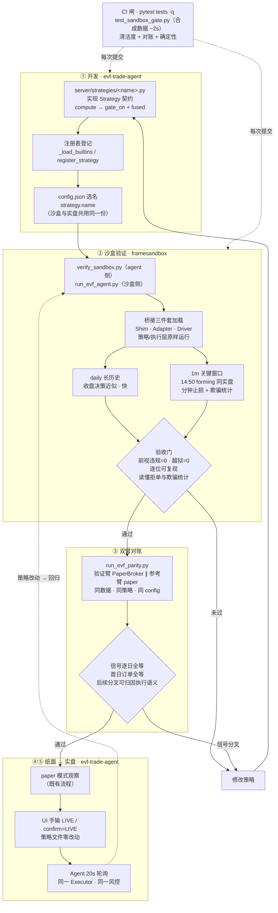
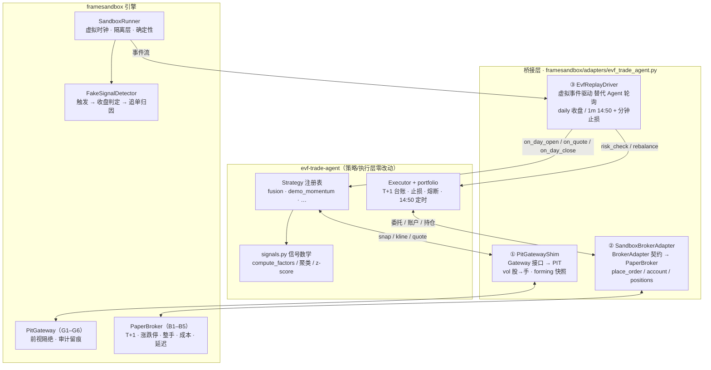
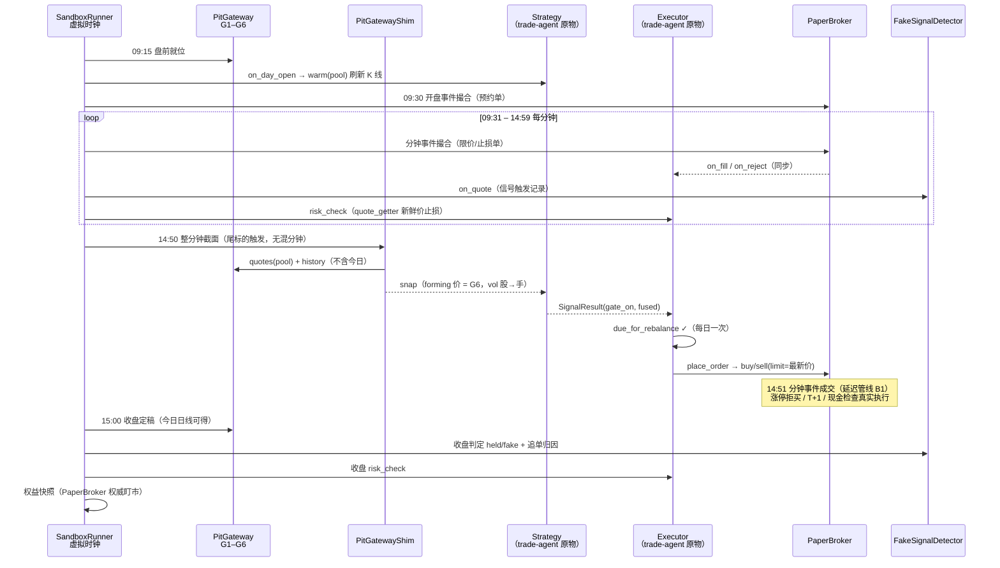
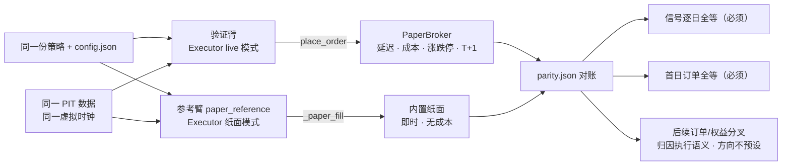

# 全流程：一次策略开发 → 沙盒验证 → 直接实盘

> 本文用 Mermaid 绘制 framesandbox × evf-trade-agent 联动的完整流程，
> 并附 2026-11-14 三个完整案例的实测记录（全部通过）。
> 架构细节见 [`INTEGRATION_TRADE_AGENT.md`](INTEGRATION_TRADE_AGENT.md)，
> 策略约束见 [`STRATEGY_CONTRACT.md`](STRATEGY_CONTRACT.md)，
> trade-agent 侧入口见其 `docs/sandbox.md`。

---

## 1 · 晋升流水线（总览）



**硬规则**：未过 ② 验收门与 ③ 对账的策略不得进 ④；沙盒报告随策略版本归档。

---

## 2 · 组件架构（三个 I/O 边界替换，其余零改动）



---

## 3 · 单个虚拟交易日时序（1m 模式，与实盘同构）



daily 模式差异：无分钟事件，决策在 `on_day_close`（收盘确认，近似声明），
成交在次日开盘事件（限价 crossing）；长历史快验用，关键窗口用 1m 复核。

---

## 4 · 双臂对账数据流



权益口径：验证臂以 **runner 权益曲线**（PaperBroker 盯市）为权威；
`Executor.status()` 是乐观内部账本（拒单先计持仓，refresh 纠正），仅作参考。

---

## 5 · 完整案例实录（2026-11-14，全部通过）

### 案例 1 · fusion · daily 长历史 + 对账 + CI 闸

```powershell
# evf-trade-agent 侧
python verify_sandbox.py --start 2024-01-01 --end 2024-06-28 --name case1_daily
python -m pytest tests/test_sandbox_gate.py -q
# framesandbox 侧
python examples\run_evf_parity.py --start 2024-01-01 --end 2024-06-28 --name case1_parity
```

| 项 | 结果 |
|---|---|
| 区间 / 交易日 | 2024-01-01 → 2024-06-28 / 117 日 |
| 期末权益 / 收益 / 回撤 | 856,653 / **-14.33%** / 19.6% |
| 成交 / 拒单 | 379 / 171（涨停拒买·现金不足·T+1） |
| 清洁度 | 前视违规 **0** · 越狱 **0** · 退出码 0 |
| CI 闸 | 2 passed（2.36s） |
| 对账 | 信号分叉 **0** 天 · 首日订单**全等** · 订单分叉 53 天（执行语义） |
| 对账权益 | 沙盒 856,653 vs 纸面 838,444（方向路径依赖） |
| 耗时 | 验证 75.7s（~0.65s/日） |
| 报告 | `evf-trade-agent/sandbox_runs/case1_daily/` · `framesandbox/runs/case1_parity/` |

**解读**：验证闸通过的是行为正确性（无前视、可复现、执行合规）；
策略本身上半年 -14.33% 是诚实的盈亏结论 —— 这正是实盘前该看到的信息。

### 案例 2 · fusion · 1m 真实分钟回放（盘中同构 + 欺骗统计）

```powershell
python examples\run_evf_agent.py --start 2026-09-29 --end 2026-10-19 --resolution 1m --name case2_1m
python examples\run_evf_parity.py --start 2026-09-29 --end 2026-10-19 --resolution 1m --name case2_parity
```

| 项 | 结果 |
|---|---|
| 区间 / 交易日 | 2026-09-29 → 2026-10-19 / 10 日（真实分钟数仓全覆盖） |
| 盘中链路 | 14:50 forming 决策每日一次 · 分钟级风控 **2162** 次 |
| 欺骗统计 | 信号触发 **759** · 假信号 **332（43.7%）** · 被追 **0** |
| 交易 | 全窗口广度门关闭 → 0 成交（门纪律生效，零追假） |
| 清洁度 | 前视违规 **0** · 越狱 **0** |
| 对账 | 信号分叉 **0** · 首日订单全等（空）· 双 0 |
| 耗时 | 57.8s |
| 报告 | `framesandbox/runs/case2_1m/` · `runs/case2_parity/` |

**解读**：近半信号是假的（43.7%），而 fusion 的广度门整个窗口把策略挡在
场外 —— 「门关·仅观察」的纪律被沙盒量化证实：零追假、零损失。
若换成盘中追单策略，同一窗口会被骗 332 次（对照 README 的 Chaser 演示）。

### 案例 3 · 新开发策略 demo_momentum · 全链路（命题直接证明）

```powershell
# ① 开发：server/strategies/demo_momentum.py + 注册表登记（四步法）
# ② 契约测试自动参数化覆盖新实现
python -m pytest tests/test_strategies.py -q          # 11 passed
# ③ 沙盒验证（--strategy 覆盖，不改 config）
python verify_sandbox.py --strategy demo_momentum --start 2024-01-01 --end 2024-06-28 --name case3_demo
# ④ 双臂对账
python examples\run_evf_parity.py --strategy demo_momentum --start 2024-01-01 --end 2024-06-28 --name case3_parity
```

| 项 | 结果 |
|---|---|
| 策略 | **新开发** mom20 单因子排序 + 广度门（复用 compute_factors） |
| 流水线改动 | **0**（注册表可插拔，桥接器自动加载） |
| 契约测试 | 11 passed（自动覆盖新实现） |
| 期末权益 / 收益 / 回撤 | 776,267 / -22.37% / 22.4% |
| 成交 / 拒单 | 93 / 44 |
| 清洁度 | 前视违规 **0** · 越狱 **0** · 退出码 0 |
| 对账 | 信号分叉 **0** · 首日订单**全等** · 订单分叉 12 天 |
| 对账权益 | 沙盒 776,267 vs 纸面 752,517 |
| 报告 | `sandbox_runs/case3_demo/` · `runs/case3_parity/` |

**解读**：从新策略文件落盘到验证/对账全过，**没有改任何流水线代码** ——
「一次策略开发，沙盒验证后直接实盘」的完整命题成立。该策略动量单因子
在 2024 上半年亏损更多（-22.37%），验证闸如实暴露，避免直接上实盘。

### 回归基线

| 套件 | 结果 |
|---|---|
| framesandbox `pytest` | **54 passed** |
| evf-trade-agent `pytest tests -q` | **217 passed, 1 skipped** |

---

## 6 · 复现命令速查

```powershell
# 沙盒侧（framesandbox 目录）
python examples\run_evf_agent.py  --start 2024-01-01 --end 2024-06-28            # daily 验证
python examples\run_evf_agent.py  --start 2026-09-29 --end 2026-10-19 --resolution 1m  # 1m 欺骗训练
python examples\run_evf_parity.py --start 2024-01-01 --end 2024-06-28            # 双臂对账
python -m pytest                                                                  # 全量 54 项

# trade-agent 侧（evf-trade-agent 目录）
python verify_sandbox.py --start 2024-01-01 --end 2024-06-28                     # 验证入口（退出码=验收）
python verify_sandbox.py --strategy demo_momentum                               # 验证候选策略
python -m pytest tests -q                                                        # 全量 + CI 闸
```
